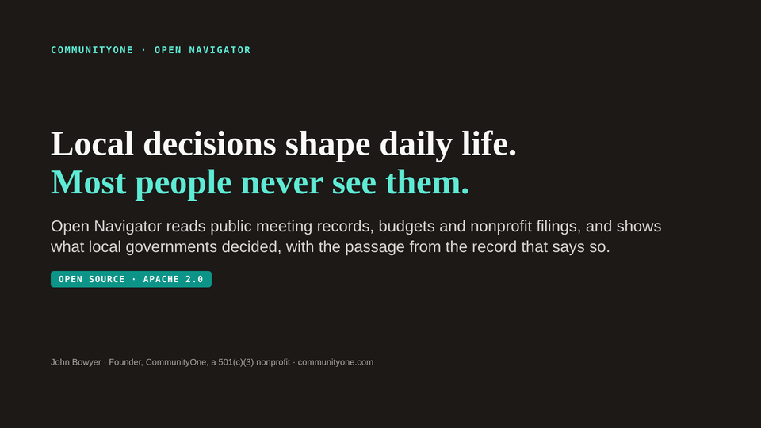

# Open Navigator
**See what your local government decided, with the record to prove it.**

**The goal: one map for every community.** The U.S. has 91,438 local governments (U.S. Census Bureau, 2025), and
each publishes its agendas, minutes, videos and budgets its own way. Open Navigator, the open-source engine behind
[CommunityOne](https://www.communityone.com) (a 501(c)(3) nonprofit), reads those public records, plus nonprofit
filings and Census data, and shows what was decided, where, and the passage from the record that says so. Nothing on
the site is a made-up number: when data is missing, it says so.

**Live:** [communityone.com](https://www.communityone.com) · [docs](https://www.communityone.com/docs) ·
[API](https://www.communityone.com/api) · Apache 2.0

<a href="web_docs/docs/pitch/full-text-and-notes.md"></a>

| For | Go to |
|---|---|
| **Executives and funders** (11 slides, 10 minutes) | [read the pitch with speaker notes](web_docs/docs/pitch/full-text-and-notes.md) · [slides](https://www.communityone.com/docs/deck/) ([source](web_docs/static/deck/index.html): download and open in a browser) |
| **Residents** | [the app](https://www.communityone.com) · [guide for citizens](web_docs/docs/for-citizens.md) |
| **Advocates and nonprofit leaders** | [guide for advocates](web_docs/docs/for-advocates.md) · [accountability strategy](web_docs/docs/guides/accountability-strategy.md) |
| **Researchers and data analysts** | [data sources](web_docs/docs/data-sources/overview.md) · [data model](web_docs/docs/data-sources/data-model-erd.md) · [citations](CITATIONS.md) |
| **Developers and data engineers** | [quick start](web_docs/docs/quickstart.md) · [architecture](web_docs/docs/architecture.md) · [how we work](AGENTS.md) |

Each role has more below. Click to open.

<details>
<summary><b>Executives and funders</b>: the pitch in ten minutes</summary>

The [slideshow](https://www.communityone.com/docs/deck/) covers who it is for, the problem, what it does, the story
lenses, the policy model, how the pipeline works, the trust rules, what is open, an honest status, and the ask.
Press **N** for speaker notes, **S** for the speaker view. The [full text and notes](web_docs/docs/pitch/full-text-and-notes.md)
has every slide's words, for reading on a phone or searching.

Where it stands: live and useful, and still uneven. Meeting analysis is deep in a few states and thin elsewhere, and
it is a small nonprofit project with one maintainer. Data, review and pilot communities help most. Contact:
johnbowyer@communityone.com.

To edit the deck, change a slide in `web_docs/deck/slides/` and run `node web_docs/scripts/build-deck.mjs`.
</details>

<details>
<summary><b>Residents</b>: what did my city or school board decide?</summary>

- Search a topic at [communityone.com](https://www.communityone.com), pick your state or city, and open any result to
  see the passage from the record it came from.
- Set up **Close to Home** for a feed of the places and issues you choose.
- Story lenses point to what is worth a look: **Contested** (split votes), **Money Moves** (contracts, grants, budget
  changes), **Raised Eyebrows** (unusual patterns, for a person to review), **Moving Fast** and **Watch Next** (votes
  coming up, where you can still speak).
- More: [guide for citizens](web_docs/docs/for-citizens.md), [community resources](web_docs/docs/citizens/community-resources.md),
  [voter registration](web_docs/docs/citizens/voter-registration.md).
</details>

<details>
<summary><b>Advocates and nonprofit leaders</b>: where is my issue moving?</summary>

- **Policy questions** follow one issue across places: each vote links to the question behind it and the arguments
  made for and against it.
- **Money and talk** puts budgets and spending next to what officials said in meetings.
- **Nonprofits**: IRS filings (Form 990) by place and cause.
- More: [guide for advocates](web_docs/docs/for-advocates.md), [accountability strategy](web_docs/docs/guides/accountability-strategy.md),
  [legislative tracking](web_docs/docs/guides/legislative-tracking.md), [case study: Tuscaloosa](web_docs/docs/case-studies/tuscaloosa-complete.md).
</details>

<details>
<summary><b>Researchers and data analysts</b>: what does the record say, at scale?</summary>

- **Open datasets** on Hugging Face: [publishing guide](web_docs/docs/guides/huggingface-publishing.md).
- **Data model**: [entity diagram](web_docs/docs/data-sources/data-model-erd.md), [marts](web_docs/docs/data-sources/marts-erd.md),
  [data contracts](web_docs/docs/development/data-contracts.md).
- **Sources and licences**: [data sources overview](web_docs/docs/data-sources/overview.md), [CITATIONS.md](CITATIONS.md).
  Meeting data follows the Council Data Project's model; places use Open Civic Data IDs.
- **AI assistants**: an MCP server lets Claude and other assistants query the data. [MCP guide](web_docs/docs/integrations/mcp-server.md).
</details>

<details>
<summary><b>Developers and data engineers</b>: run it, change it</summary>

**Stack.** FastAPI (`api/`), React + Vite + TypeScript (`web_app/`), Docusaurus (`web_docs/`), dbt on PostgreSQL
(`dbt_project/`: bronze → staging → intermediate → marts), shared Python libraries in `packages/` (a uv workspace).
`scripts/` is legacy and frozen: new Python goes in `packages/`. Rules: [CLAUDE.md](CLAUDE.md) and [AGENTS.md](AGENTS.md).

**Run it locally** (API on 8001, app on 5173, docs on 3000):

```bash
git clone https://github.com/getcommunityone/open-navigator.git && cd open-navigator
./install.sh                        # Python backend (.venv + .env); on Windows: .\install.ps1
cd web_app && npm install && cd ..
cd web_docs && npm install && cd ..
./start-all.sh                      # on Windows: .\start-all.ps1
```

Don't use `uv sync` for the backend: the root `pyproject.toml` is a workspace and skips `requirements.txt`. Full setup,
including restoring a warehouse snapshot: [quick start](web_docs/docs/quickstart.md).

**Data pipeline.** Python only for ingestion, AI extraction and orchestration; every SQL transformation is dbt.

```bash
cd dbt_project && dbt run && dbt test
```

More: [dbt strategy](web_docs/docs/development/dbt-etl-strategy.md), [entity resolution](web_docs/docs/development/bronze-to-production-merge.md),
[dbt project](dbt_project/README.md), [refactor roadmap](web_docs/docs/development/cleanup-roadmap.md).

**Deploy.** [Hugging Face Spaces](web_docs/docs/deployment/huggingface-spaces.md) (this README's front matter configures
the Space), [Databricks Apps](web_docs/docs/deployment/databricks-apps.md), or `docker-compose up -d`.

**Test.** `pytest` for the backend; CI also builds the app and the docs and checks the slideshow is up to date.

**Contribute.** Every change starts from a GitHub issue with four parts (Problem, Done when, Contract, Read first),
on a branch `<type>/<issue>-<slug>`, through a pull request that closes it. See [AGENTS.md](AGENTS.md) and
[CONTRIBUTING.md](CONTRIBUTING.md).
</details>

---

Sources: U.S. Census Bureau, [Government Organization Summary Report: 2022 & 2025](https://www.census.gov/library/publications/2026/econ/govtorg2225.html).
Datasets and research used here: [CITATIONS.md](CITATIONS.md) (including MeetingBank, Hu et al., ACL 2023).
All generated content should be reviewed by a person before use in advocacy.
Issues: [github.com/getcommunityone/open-navigator/issues](https://github.com/getcommunityone/open-navigator/issues) ·
johnbowyer@communityone.com · Apache 2.0, see [LICENSE](LICENSE).
